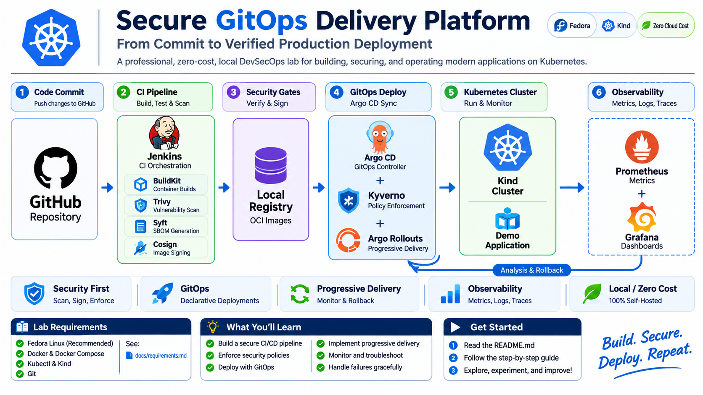
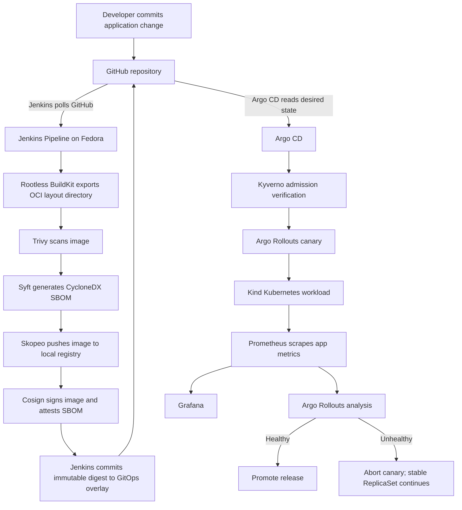

<div align="center">
  

  # Secure GitOps Delivery Platform
  **From Commit to Verified Production Deployment**

  A self-hosted, zero-cloud-cost DevSecOps and Platform Engineering lab built around GitHub, Jenkins, Kubernetes, GitOps, image-signing, admission control and progressive delivery.
</div>

---

## Start here

**Before running commands, read [`docs/requirements.md`](docs/requirements.md).** It documents the Fedora Linux baseline, host dependencies, versions, hardware sizing and network/cost expectations. This lab targets Fedora Workstation 44 x86_64.

- [Requirements — Fedora Linux](docs/requirements.md)
- [Tooling Education Guide — what every tool does and why we use it](docs/tools-education-guide.md)
- [Architecture and trust boundaries](docs/architecture.md)
- [Canary-failure incident runbook](docs/runbooks/incident-canary-failure.md)
- [Test plan and acceptance criteria](docs/test-plan.md)

> **GitHub replaces the self-hosted Git service.** GitHub is the remote SCM. Jenkins runs locally and polls GitHub; the pipeline does not use GitHub Actions or GitHub-hosted runners. No inbound webhook or public tunnel is needed.

> **Viewing the flow diagrams:** GitHub renders the Mermaid diagrams in Markdown natively, so no browser extension is needed when reading this README on GitHub. For a local Markdown preview in Cursor/VS Code, use Mermaid preview support in your editor. Search Extensions for **Markdown Preview Mermaid Support** (`bierner.markdown-mermaid`) if your editor does not render Mermaid blocks. In VS Code 1.121 and newer, Mermaid preview support is included in the built-in Markdown preview. Mermaid support is only for rendering the diagrams; it is not a lab runtime dependency.

## 1. What this project demonstrates

This is intended to look and behave like a small internal software-delivery platform, not a collection of disconnected YAML examples.

| Capability | Implementation | Evidence you can show |
|---|---|---|
| Source control | GitHub repository | Commit history and GitOps digest commit |
| Local CI | Jenkins Pipeline | Pipeline stages and archived reports |
| Container builds | Rootless BuildKit | OCI image archive and reproducible build steps |
| Vulnerability management | Trivy | JSON scan report; critical findings fail the gate |
| SBOM generation | Syft | CycloneDX JSON artifact |
| Image signing | Cosign key pair | Signature and signed SBOM attestation |
| Artifact storage | Local OCI Registry | Published immutable image digest |
| Registry visibility | Secure Delivery OCI Registry Dashboard | Images, tags and content digests in the local registry |
| GitOps | Argo CD | Git-to-cluster reconciliation and sync status |
| Admission security | Kyverno | Unsigned image and unrestricted Pod are rejected |
| Progressive delivery | Argo Rollouts | Replica-based canary, metric analysis and abort |
| Observability | Prometheus and Grafana | Application HTTP metrics and rollout health query |

### End-to-end delivery model



The white-background image at the top is a visual overview. The Mermaid diagram above and the manifests in `gitops/` are the precise implementation reference. The artwork is conceptual; this version of the lab implements metrics and rollout analysis with Prometheus/Grafana, while centralized logs and distributed tracing are intentionally left as future extensions.

## 2. Architecture and local components

### Source-control and CI layer — Docker Compose

| Component | Role | Host access |
|---|---|---|
| GitHub | Source repository and GitOps history | `github.com` |
| Jenkins LTS | Local CI orchestrator; polls GitHub | `http://127.0.0.1:8080` |
| BuildKit rootless | Builds OCI image without mounting the host Docker socket into Jenkins | Internal Compose network only |
| OCI Registry | Stores built images and Cosign artifacts | `http://127.0.0.1:5000` |
| Registry Dashboard | Read-only browser UI for the local registry | `http://127.0.0.1:8082` |

### Kubernetes platform — Kind

| Component | Role |
|---|---|
| Argo CD | Reconciles `gitops/overlays/local` from GitHub |
| Kyverno | Verifies signatures and enforces restricted Pod settings |
| Argo Rollouts | Performs replica-based canary progression |
| Prometheus | Scrapes application metrics and evaluates error counts |
| Grafana | Displays the monitoring stack and Prometheus data |
| Demo application | Small HTTP service with `/`, `/healthz`, `/readyz` and `/metrics` |

The Kind cluster is named `delivery-lab`. The Compose registry container is attached to the Kind Docker network by `scripts/create-kind-cluster.sh`, so Kubernetes nodes can pull images from `kind-registry:5000`.

## 3. Versions used by this repository

The repository pins the main components for repeatable setup. Review upstream release notes before changing these pins.

| Component | Version / reference |
|---|---|
| Fedora target | Fedora Workstation 44 x86_64 |
| Kind | `v0.33.0` |
| Kubernetes node image | `kindest/node:v1.37.0` (digest pinned in the cluster script) |
| kubectl | Kubernetes `v1.37` stable channel |
| Jenkins | `jenkins/jenkins:2.591-jdk21` |
| BuildKit | `v0.35.0` rootless |
| Trivy | `v0.76.2` |
| Syft | `v1.57.1` |
| Cosign | `v3.1.4` |
| Argo CD | `v3.6.1` |
| Kyverno | `v1.20.0` via Helm chart `3.10.0` |
| Argo Rollouts | `v1.10.2` |
| kube-prometheus-stack | Helm chart `93.9.0` |
| OCI Registry | `registry:3` |

Official release references: [Kind](https://github.com/kubernetes-sigs/kind/releases), [Argo CD](https://github.com/argoproj/argo-cd/releases), [Kyverno](https://kyverno.io/docs/installation/releases/), [Argo Rollouts](https://github.com/argoproj/argo-rollouts/releases), [Prometheus community charts](https://github.com/prometheus-community/helm-charts), [Jenkins Docker image](https://www.jenkins.io/doc/book/installing/docker/), [Trivy](https://github.com/aquasecurity/trivy/releases), [Syft](https://github.com/anchore/syft/releases), [Cosign](https://github.com/sigstore/cosign/releases), [BuildKit](https://github.com/moby/buildkit/releases).

## 4. Repository layout

```text
secure-gitops-delivery-platform/
├── application/                 # Demo service and Dockerfile
├── ci/                           # Jenkins image, plugins and Jenkinsfile
├── docs/
│   ├── assets/                   # Architecture artwork used by this README
│   ├── requirements.md           # Fedora installation and host prerequisites
│   ├── tools-education-guide.md  # What each tool does, why it is used, and how components interact
│   ├── architecture.md           # Trust boundaries and design decisions
│   └── runbooks/                 # Incident response steps
├── gitops/
│   ├── root-application.yaml     # Argo CD root Application
│   └── overlays/local/           # Kustomize workload, Rollout and monitoring
├── platform/
│   ├── kind/                     # Kind cluster and registry configuration
│   └── monitoring/               # Prometheus/Grafana Helm values
├── scripts/                      # Setup, policy, verification and demo helpers
├── security/
│   ├── cosign/                   # Local key pair (private key is gitignored)
│   └── policies/                 # Kyverno policies and key template
└── tests/                        # Admission-policy fixtures and test runner
```

## 5. Prerequisites

**Complete the detailed installation first:** [`docs/requirements.md`](docs/requirements.md).

The required host tools are Docker Engine, Docker Compose, kubectl, Kind, Helm 3, Git, curl, Python 3, OpenSSL, jq and Cosign. Install the Argo Rollouts kubectl plugin as described in the requirements guide.

The Jenkins image contains Trivy, Syft, Cosign, BuildKit client and Skopeo. You do not need to install those tools separately on Fedora.

## 6. Create the GitHub repository

1. Create an **empty public GitHub repository** named `secure-gitops-delivery-platform`. Do not initialize it with a README, license or `.gitignore`; this repository already contains those files.
2. Extract this ZIP archive and enter the project directory.
3. Configure the Argo CD repository URL, then create the Git repository and push the first commit.

```bash
cd secure-gitops-delivery-platform

./scripts/configure-repository.sh \
  https://github.com/YOUR_GITHUB_USERNAME/secure-gitops-delivery-platform.git

git init -b main
git add .
git commit -m "chore: bootstrap secure GitOps delivery platform"
git remote add origin \
  https://github.com/YOUR_GITHUB_USERNAME/secure-gitops-delivery-platform.git
git push -u origin main
```

Replace `YOUR_GITHUB_USERNAME` with your GitHub username in both places. The configuration script updates `gitops/root-application.yaml`.

**Why public?** Argo CD can clone a public repository without extra repository credentials. The lab does not need to store a GitHub read token in Kubernetes. You can use a private repository later, but must configure Argo CD repository credentials separately.

## 7. Start the local CI services

From the repository root:

```bash
./scripts/start-local-services.sh
```

This builds the custom Jenkins image and starts Jenkins, rootless BuildKit, the registry and registry dashboard. Host ports are bound to loopback only:

- Jenkins: `http://127.0.0.1:8080`
- Registry API: `http://127.0.0.1:5000/v2/`
- Registry Dashboard: `http://127.0.0.1:8082/`

Retrieve the Jenkins unlock password if the helper did not print it:

```bash
docker compose exec jenkins \
  cat /var/jenkins_home/secrets/initialAdminPassword
```

Open Jenkins, unlock it, and create the first administrator. The required plugins are already installed by `ci/Dockerfile`; you can skip installing additional suggested plugins for this POC.

### Secure Delivery OCI Registry Dashboard

The dashboard is a browser UI for inspecting repositories, tags, tag history and content digests in the local OCI registry. Jenkins publishes the demo image and Cosign signature/attestation artifacts to that same registry; Kind pulls images from it over the Docker network. The UI provides visibility into stored artifacts and does not take part in image signing, verification or deployment.

Compose defines it as `registry-ui`, attached to `secure-delivery-net`, with `NGINX_PROXY_PASS_URL=http://kind-registry:5000`. It is configured for one registry, with image deletion disabled, digest and tag-history display enabled, and a 1000-item catalog limit. The UI is unauthenticated, so Compose binds it to loopback only. The image is currently `joxit/docker-registry-ui:latest`.

To start or stop only the dashboard:

```bash
docker compose up -d registry-ui
docker compose stop registry-ui
```

Open <http://127.0.0.1:8082>. Remove the stopped container with `docker compose rm -f registry-ui`. The `kind-registry` dependency is started automatically when needed. Override the dashboard's host port by setting `REGISTRY_UI_HTTP_PORT` in `.env` (copied from `.env.example` on the first full startup); it defaults to `8082` so it does not conflict with Argo CD's port-forward on `8081`. No dashboard-specific host tools or credentials are required. This repository has an architecture overview image but no dashboard screenshot.

## 8. Generate and initialize your local Cosign key pair

The project does not fetch keys from a separate repository. Each clone creates its own key pair locally; only the public key is committed so the Jenkins checkout and cluster use the same verification identity. The private key remains in your local working tree and is never committed.

```bash
./scripts/init-cosign-keys.sh
```

The script prompts for a non-empty passphrase and writes:

- `security/cosign/cosign.key` — encrypted private key, mode `0600`, ignored by Git.
- `security/cosign/cosign.pub` — public key, used by Kyverno and safe to commit.

The initializer refuses to overwrite an existing key. To deliberately rotate the key, run `./scripts/init-cosign-keys.sh --rotate`; then update Jenkins credentials, commit the new public key, and reapply Kyverno's policy before building or admitting images. Images signed by the old key will no longer satisfy the updated policy, so publish and deploy a newly signed digest.

Commit and push the public key before the Jenkins job builds:

```bash
git add security/cosign/cosign.pub
git commit -m "chore(security): add Cosign public verification key"
git push origin main
```

### Add Jenkins credentials

In Jenkins, open **Manage Jenkins → Credentials → System → Global credentials → Add Credentials** and create these credentials with the exact IDs. The Secret File is provisioned from the local `security/cosign/cosign.key`; Jenkins does not retrieve it from Git or an external key repository. Before signing, the pipeline derives its public key and compares it with the checked-out `security/cosign/cosign.pub`.

| Credential ID | Kind | Value |
|---|---|---|
| `cosign-private-key` | Secret file | Upload `security/cosign/cosign.key` |
| `cosign-password` | Secret text | The passphrase used to generate the key |
| `github-write-token` | Username with password | Username `x-access-token`; password is a fine-grained GitHub PAT with `Contents: Read and write` on this repository only |

Create the fine-grained token in GitHub Settings → Developer settings → Personal access tokens. Grant only access to this one repository and the **Contents: Read and write** permission. Do not paste the token in the Jenkinsfile or commit it to Git.

The GitHub repository should allow the Jenkins bot to push directly to `main` for this lab. If you enable branch protection that requires pull requests, adapt the pipeline to create a pull request instead of pushing directly.

## 9. Create the Jenkins Pipeline job

In Jenkins:

1. Select **New Item** and create a **Pipeline** job named `secure-gitops-delivery`.
2. Under **Pipeline**, choose **Pipeline script from SCM**.
3. SCM: **Git**.
4. Repository URL: `https://github.com/YOUR_GITHUB_USERNAME/secure-gitops-delivery-platform.git`.
5. Credentials: none for a public repository. For a private repository, select `github-write-token` (Username with password; PAT in the password field) or another credential with repository read access.
6. Branch specifier: `*/main`.
7. Script path: `ci/Jenkinsfile`.
8. Save and click **Build Now** for the first run.

The Jenkinsfile enables `pollSCM('H/2 * * * *')`, so Jenkins polls GitHub approximately every two minutes after the job's first run. No webhook is required and no inbound port is exposed.

### What the first build does

1. Detects that the application needs a build.
2. Builds an OCI image layout directory using the rootless BuildKit daemon.
3. Scans the image with Trivy. Any **CRITICAL** finding fails the pipeline; lower severities remain in the JSON report for review.
4. Generates a CycloneDX SBOM with Syft.
5. Pushes the image to the local registry using Skopeo.
6. Signs the image digest and attests the SBOM with Cosign.
7. Commits the immutable image digest to `gitops/overlays/local/kustomization.yaml` in GitHub.
8. Archives the Trivy report, CycloneDX SBOM, BuildKit metadata, and built and pushed image digests in the Jenkins build.

BuildKit exports `artifacts/delivery-demo.oci` with `type=oci,tar=false`; it is a directory containing `index.json`, `oci-layout` and content-addressed blobs, not an OCI tarball. Trivy scans that directory with `--input`, Syft reads it as `oci-dir:`, and Skopeo reads it as `oci:`. BuildKit's `containerimage.digest` is recorded from `build-metadata.json`; after Skopeo pushes the image, Jenkins compares the registry digest with that value and refuses to sign if they differ. The signing stage generates a Cosign signing configuration with the transparency-log services removed, as required by Cosign 3.1.4 for this local lab. The full OCI layout stays in the workspace only and is removed by `cleanWs`; reports and digest metadata remain downloadable from the Jenkins build's **Artifacts** section.

To inspect archived outputs, open the completed Jenkins build and select **Artifacts**. `trivy-report.json` contains the full scan report, `sbom.cdx.json` is the CycloneDX inventory, and `build-metadata.json`, `build-image-digest.txt`, `image-digest.txt` and `image-ref.txt` record the build and publication identity. Jenkins console output remains available for stage-level diagnostics.

The first successful run must finish before you install the Argo CD root Application. The Kustomize file starts with a deliberately invalid placeholder digest so that an unbuilt image cannot accidentally be deployed.

## 10. Create the Kind cluster

Ensure the Compose registry is running, then:

```bash
./scripts/create-kind-cluster.sh
```

The script creates a three-node Kind cluster (`delivery-lab`) using Kubernetes `v1.37.0`, connects the local registry to the Kind Docker network, and configures containerd on each node to use the local HTTP registry.

Verify:

```bash
kubectl config current-context
kubectl get nodes -o wide
docker network inspect kind
```

Expected context: `kind-delivery-lab`.

## 11. Install the Kubernetes platform

```bash
./scripts/install-platform.sh
```

This installs:

- Argo CD `v3.6.1` (non-HA profile for local use)
- Kyverno `v1.20.0` (Helm chart `3.10.0`)
- Argo Rollouts `v1.10.2`
- kube-prometheus-stack chart `93.9.0`

The install script enables Kyverno's `--allowInsecureRegistry` option because the lab registry is HTTP. **This is for the loopback-only lab registry and must not be copied into a production environment.**

Check controller Pods:

```bash
kubectl get pods -n argocd
kubectl get pods -n kyverno
kubectl get pods -n argo-rollouts
kubectl get pods -n monitoring
```

## 12. Install Kyverno policies

```bash
./scripts/install-kyverno-policies.sh
```

The script renders the image verification policy using `security/cosign/cosign.pub` and applies two policies:

- `verify-delivery-demo-images`: requires a valid Cosign signature for `kind-registry:5000/delivery-demo` images and requires a digest.
- `require-restricted-delivery-demo-pods`: requires non-root execution, `RuntimeDefault` seccomp, no privilege escalation, read-only root filesystem and dropped Linux capabilities.

Verify:

```bash
kubectl get clusterpolicies
kubectl describe clusterpolicy verify-delivery-demo-images
kubectl describe clusterpolicy require-restricted-delivery-demo-pods
```

## 13. Apply the Argo CD root Application

Only do this after the first Jenkins build has pushed an image and updated the GitOps digest.

```bash
./scripts/install-root-application.sh
```

Watch reconciliation:

```bash
kubectl get applications -n argocd -w
kubectl get rollouts,pods,services -n delivery-demo -w
```

Argo CD reads the GitHub repository, applies the Kustomize overlay and maintains the desired state. Jenkins never invokes `kubectl` and never deploys directly.

### Retrieve the Argo CD initial admin password

```bash
kubectl -n argocd get secret argocd-initial-admin-secret \
  -o jsonpath='{.data.password}' | base64 -d; echo
```

Username: `admin`. Change the password after first login if you keep the lab running.

## 14. Open dashboards and test the application

Start local port forwards in a dedicated terminal:

```bash
./scripts/port-forwards.sh
```

| Service | URL | Local credentials |
|---|---|---|
| Argo CD | `https://127.0.0.1:8081` | `admin` + initial password above |
| Grafana | `http://127.0.0.1:3000` | `admin` / `local-lab-only-change-me` |
| Prometheus | `http://127.0.0.1:9090` | No authentication in this local lab |
| Demo app stable Service | `http://127.0.0.1:8088` | No authentication |

The Grafana password is deliberately simple for this isolated lab. Change it before any non-local use.

Test the service:

```bash
curl -i http://127.0.0.1:8088/
curl -i http://127.0.0.1:8088/healthz
curl -i http://127.0.0.1:8088/readyz
```

Verify rollout status:

```bash
kubectl argo rollouts get rollout delivery-demo -n delivery-demo
kubectl get pods -n delivery-demo -o wide
```

## 15. Run the admission-policy negative tests

These tests use server-side dry-run, so they do not leave Pods behind.

```bash
./tests/run-admission-tests.sh
```

Expected results:

- The unrestricted/root Pod is denied by the restricted-Pod policy.
- The unsigned local image is denied by the Cosign signature-verification policy.

If either test is admitted, stop and inspect the Kyverno policy status before calling the POC complete.

## 16. Demonstrate an unhealthy canary and automatic abort

This is the key operational scenario. The repository includes a fault-injection switch that causes the new application image to return HTTP 503 on `/`. Health and metrics endpoints remain available so Kubernetes can observe the process and Prometheus can count failed application requests.

First make sure your working tree is clean and pull the GitOps digest commit created by Jenkins:

```bash
git pull --rebase origin main
git status --short
```

Then enable fault injection and push the change:

```bash
./scripts/demo-bad-rollout.sh
```

Expected behavior:

1. Jenkins detects the new file in `application/`.
2. BuildKit builds an image with `FAIL_REQUESTS=true`.
3. Trivy, Syft and Cosign run as usual.
4. Jenkins pushes the new image digest to GitHub's GitOps overlay.
5. Argo CD syncs the new digest.
6. Argo Rollouts creates a canary ReplicaSet.
7. The in-cluster load generator targets `delivery-demo-canary`; the unhealthy version responds with HTTP 503.
8. Prometheus observes `app_http_requests_total{status="503"}`.
9. The AnalysisTemplate fails and Argo Rollouts aborts the canary. The previous stable ReplicaSet continues to serve the stable Service.

Watch the rollout and query the metric:

```bash
kubectl argo rollouts get rollout delivery-demo -n delivery-demo --watch
kubectl get analysisruns -n delivery-demo
```

Prometheus query:

```promql
sum(increase(app_http_requests_total{status="503"}[2m])) or vector(0)
```

Verify that the stable Service is still responding:

```bash
curl -i http://127.0.0.1:8088/
```

### Restore a healthy release

```bash
./scripts/restore-healthy-release.sh
```

Jenkins builds and signs a healthy image, updates the GitOps digest and Argo CD reconciles it. Observe the next rollout and confirm that the analysis passes.

**Important GitOps distinction:** Argo Rollouts aborts the unhealthy canary and keeps the old stable ReplicaSet serving. It does not rewrite Git history. The desired state is corrected by the follow-up healthy commit, preserving Git as the source of truth.

## 17. Verify an image signature and SBOM attestation manually

After a successful Jenkins build, copy the immutable digest from the Jenkins build artifacts or the GitOps file. Example:

```bash
IMAGE_DIGEST="sha256:<digest-from-the-build>"
IMAGE_REF="kind-registry:5000/delivery-demo@${IMAGE_DIGEST}"
```

The local registry is HTTP, so pass Cosign's explicit lab-only HTTP option:

```bash
cosign verify --allow-http-registry --key security/cosign/cosign.pub "$IMAGE_REF"
cosign verify-attestation --allow-http-registry --key security/cosign/cosign.pub \
  --type cyclonedx "$IMAGE_REF"
```

The signature proves which key signed the image digest. The signed CycloneDX attestation binds the generated SBOM to that digest. Kyverno's admission rule in this POC enforces the image signature; the attestation is generated and can be verified manually.

## 18. Useful day-to-day commands

```bash
# Local CI services
docker compose ps
docker compose logs -f jenkins
docker compose logs -f buildkitd
docker compose logs -f kind-registry
docker compose logs -f registry-ui

# Kubernetes context and workloads
kubectl config get-contexts
kubectl get nodes -o wide
kubectl get pods -A
kubectl get applications -n argocd
kubectl get clusterpolicies
kubectl get rollouts,analysisruns -n delivery-demo

# Re-run platform health checks
./scripts/verify-platform.sh

# Stop local CI services (named volumes are preserved)
docker compose down

# Delete only the Kind cluster (CI and registry volumes are preserved)
./scripts/cleanup.sh
```

To remove all data, including Jenkins configuration and registry images, use `docker compose down -v`. This is destructive.

## 19. Troubleshooting

| Symptom | Likely cause | Check / fix |
|---|---|---|
| Jenkins cannot reach BuildKit | BuildKit container is still starting or Compose network issue | `docker compose logs buildkitd`; restart `docker compose up -d buildkitd` |
| Skopeo cannot push | Registry is not running or Jenkins cannot resolve it | `docker compose ps`; `docker compose exec jenkins getent hosts kind-registry` |
| Trivy reports missing `manifest.json` or says `index.json` is not a directory | BuildKit output is an OCI tarball, which Trivy does not accept as `--input` | Confirm the pipeline uses `type=oci,...,tar=false` and that `artifacts/delivery-demo.oci/index.json` exists |
| Registry dashboard does not open | Dashboard is stopped or its host port is occupied | `docker compose ps registry-ui`; check `REGISTRY_UI_HTTP_PORT` in `.env`, then `docker compose up -d registry-ui` |
| Registry dashboard shows no repositories | Registry is empty or Jenkins has not pushed an image yet | Check `docker compose logs registry-ui kind-registry`, then confirm a successful Jenkins push and reload the dashboard |
| Cosign initializer refuses to run | A key or public key already exists | Back up the current key pair before intentional rotation; then use `./scripts/init-cosign-keys.sh --rotate` only when replacing the signing identity |
| Jenkins reports a Cosign key mismatch | Jenkins Secret File differs from the checked-out public key | Re-provision `cosign-private-key` and `cosign-password` from the same local pair in `security/cosign/`, and ensure the matching public key is committed |
| Jenkins reports a missing credential ID | The global credential has not been created or its ID differs | Add the required credentials exactly as `cosign-private-key`, `cosign-password`, and `github-write-token` under **Manage Jenkins → Credentials** |
| Jenkins cannot check out a private GitHub repository | The Pipeline job has no SCM read credential selected | Edit the job's SCM configuration and select `github-write-token` or another credential with repository read access |
| Kind Pods show `ImagePullBackOff` | Registry not connected to the `kind` network or `hosts.toml` missing | Re-run `scripts/create-kind-cluster.sh`; inspect `/etc/containerd/certs.d/kind-registry:5000/hosts.toml` in each node |
| Jenkins Git push is rejected | Token lacks Contents write, wrong repository, branch protection, or host branch is ahead | Verify `github-write-token`; check GitHub branch rules; retry after resolving non-fast-forward |
| Argo CD repository error | Wrong repo URL or repo is private | Check `gitops/root-application.yaml`; use public repo or configure Argo CD repo credentials |
| Kyverno rejects a correctly signed image | Public key mismatch, digest mismatch, local registry HTTP not enabled, or signature push failed | Check `cosign.pub`, Jenkins logs, Kyverno logs and `--allowInsecureRegistry` argument |
| Prometheus has no app metrics | ServiceMonitor not selected or app Pods not ready | `kubectl get servicemonitor -n delivery-demo -o yaml`; verify label `release: monitoring` |
| Canary does not fail during fault injection | Load generator is not reaching canary Service, or AnalysisTemplate has no samples | Check load-generator Pod, `delivery-demo-canary` endpoints, and Prometheus query |
| Critical Trivy finding blocks build | Base image or application dependency has a critical CVE | Review `trivy-report.json`; update base image/dependencies, rebuild and re-run |

More incident guidance: [`docs/runbooks/incident-canary-failure.md`](docs/runbooks/incident-canary-failure.md).

## 20. Security boundaries and limitations

This is a local engineering POC, not a production-ready reference deployment.

- Jenkins runs a built-in executor for convenience. Production Jenkins should use isolated, ephemeral agents and least-privilege credentials.
- The Jenkins controller has no host Docker socket mounted. It talks to a separate rootless BuildKit daemon.
- GitHub PAT is stored in Jenkins Credentials and scoped to this repository. It is used only to push the GitOps digest commit.
- The local registry uses HTTP and Kyverno's insecure-registry option. This is acceptable only for a loopback-bound, isolated lab.
- Cosign uses a self-managed key pair and disables transparency-log upload for offline/local signing. Production key management should use a KMS/HSM or keyless OIDC and a transparency log.
- The canary strategy is replica-based. Exact percentage traffic splitting would require a traffic router such as NGINX, Gateway API or a service mesh.
- The default Trivy gate blocks CRITICAL findings; HIGH/MEDIUM/LOW findings are included in the report for review. Change the policy to suit your risk model.
- GitHub is external SCM and the initial setup needs internet access. All compute, CI execution, artifact storage, GitOps controllers and monitoring are local.

## 21. Completion checklist

- [ ] Fedora host prerequisites installed and validated.
- [ ] Empty GitHub repository created and initial code pushed.
- [ ] Jenkins, BuildKit and local registry running in Docker Compose.
- [ ] Locally generated Cosign private key stays gitignored and is provisioned to Jenkins Credentials; matching public key is committed.
- [ ] Registry dashboard is available on its configured loopback port.
- [ ] Jenkins Pipeline builds, scans, generates SBOM, signs and pushes image.
- [ ] Jenkins writes the immutable digest to the GitOps overlay.
- [ ] Kind cluster and local-registry network integration are healthy.
- [ ] Argo CD, Kyverno, Argo Rollouts, Prometheus and Grafana are ready.
- [ ] Kyverno denies root/unrestricted Pods and unsigned images.
- [ ] Argo CD syncs the GitOps application from GitHub.
- [ ] Healthy rollout is visible in the Argo Rollouts CLI.
- [ ] Fault-injection canary fails Prometheus analysis and is aborted.
- [ ] Stable application remains available during the failed canary.
- [ ] Healthy GitOps commit restores the desired state.
- [ ] README, architecture diagram, runbook and Jenkins artifacts are ready for portfolio evidence.

---

**Build. Secure. Deploy. Repeat.**
