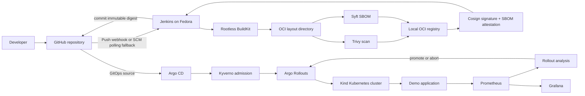

# Architecture and design decisions

## System boundary

This page describes how the lab components interact and where their trust boundaries sit. GitHub is the only mandatory hosted service; Jenkins, BuildKit, the OCI registry, Kind, Argo CD, Kyverno, Argo Rollouts, Prometheus and Grafana run locally.

Jenkins supports GitHub push webhooks and polls GitHub approximately every 15 minutes as a fallback. The webhook can start builds immediately when Jenkins is reachable from GitHub; the local loopback-only configuration cannot receive internet webhooks by default. Polling requires no public endpoint. GitHub is used as SCM, not as the CI execution environment.

## Delivery flow

## Trust boundaries

- GitHub repository contents are trusted only after pipeline checks.
- Jenkins is allowed to write a single image digest to the GitOps overlay. It does not use `kubectl` and does not have a Kubernetes service-account token.
- The BuildKit daemon is rootless and reachable only on the private Docker Compose network.
- The OCI registry is HTTP because it is a private local lab service. It is bound to `127.0.0.1` on the host and is never published externally.
- Cosign uses a locally generated key pair. The private key is provisioned from the local ignored file into Jenkins as a Secret File credential; the Jenkins pipeline checks it matches the public key in the Git checkout before signing.
- Kyverno verifies image signatures using only the public key. The local HTTP registry exception is enabled only for this lab.
- The Registry Dashboard runs on the Compose network, proxies to the local registry and is exposed on loopback at port `8082` by default.
- Argo CD reads desired state from GitHub and reconciles Kubernetes. It is the only component responsible for applying GitOps resources.

## Progressive-delivery behavior

The Rollout uses replica-based canary progression (25%, then 50%, then 100%). It does not claim exact HTTP traffic splitting. The canary Service is targeted by a small in-cluster load generator. Prometheus counts HTTP 503 responses and Argo Rollouts evaluates the count at each analysis step. If analysis fails, the rollout aborts and the prior stable ReplicaSet remains the serving version. Git remains the desired-state source; after investigating a failed release, push a healthy commit to build and publish a corrected digest.

## Local-only caveats

The registry uses HTTP and Kyverno is configured with `--allowInsecureRegistry`. This is intentionally restricted to the loopback-only lab registry. Do not reuse that configuration for production. Likewise, Jenkins is a single local controller with a built-in executor for learning purposes, not a hardened production controller.
