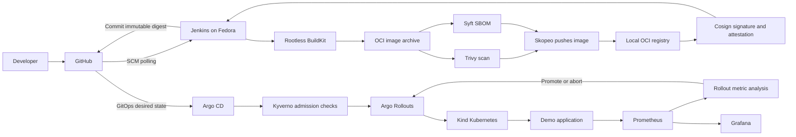

# Tooling Education Guide

## Secure GitOps Delivery Platform

This guide explains every major tool used by this lab, why it is present, where it fits in the delivery process, and how to inspect it while working through the project. Read it alongside the [Fedora requirements](requirements.md), [architecture and trust boundaries](architecture.md), and the [main README](../README.md).

The goal is not to memorize product names. The goal is to understand the job each component performs, which component it talks to, and which responsibility it must **not** take over.

---

## 1. The big picture

The platform is split into two execution zones:

- **Fedora host and Docker Compose:** Git tools, the local Jenkins controller, rootless BuildKit, and the OCI registry.
- **Kind Kubernetes cluster:** Argo CD, Kyverno, Argo Rollouts, the demo application, Prometheus, Grafana, and Alertmanager.

GitHub is the remote source-control service. It is the only mandatory hosted service. The pipeline executes locally on Jenkins; it does not use GitHub Actions or GitHub-hosted runners.



### The most important responsibility boundary

Jenkins **builds and verifies** an artifact, then commits the artifact's immutable digest to GitHub. Jenkins does not run `kubectl apply` and does not deploy directly to the cluster. Argo CD reads the updated Git repository and reconciles Kubernetes to match it. Kyverno evaluates admission policies when Kubernetes receives resources. Argo Rollouts controls the staged release after the desired state is applied.

That separation is the core GitOps design demonstrated by this project.

---

## 2. Source control: Git and GitHub

### Git

**What it is:** Git is a distributed version-control system. It records changes as commits and lets engineers compare, branch, review, and restore source code and configuration.

**Why this lab uses it:** Both the application source and the Kubernetes desired state are versioned. The commit history gives us an auditable record of what changed and when. Jenkins also uses Git history to identify whether a commit changed the application or CI files.

**How it is used here:**

1. A developer commits application or pipeline changes.
2. The developer pushes commits to GitHub.
3. Jenkins checks out the `main` branch.
4. After a successful build, Jenkins commits the newly produced image digest to `gitops/overlays/local/kustomization.yaml` and pushes that GitOps change back to GitHub.

Useful commands:

```bash
git status --short
git log --oneline --decorate -10
git diff --stat
git pull --rebase origin main
git push origin main
```

### GitHub

**What it is:** GitHub hosts Git repositories and provides pull requests, access control, and collaboration features.

**Why this lab uses it:** GitHub is the shared source of truth for application code and GitOps configuration. It replaces a self-hosted Git service. Keeping GitHub as SCM does **not** mean using GitHub Actions: all CI jobs still execute on the local Jenkins instance.

**How it is used here:** Jenkins polls GitHub approximately every two minutes. Polling avoids exposing a laptop-hosted Jenkins endpoint to the public internet for inbound webhooks. A Jenkins credential named `github-write-token` is used only when the pipeline must push the GitOps digest commit. For a public repository, Argo CD can clone without repository credentials.

**Credential principle:** Use a fine-grained token with only the repository access and `Contents: Read and write` permission needed for the Jenkins push. Store it as a Jenkins credential, never in the repository, a YAML manifest, or the Jenkinsfile.

---

## 3. Container runtime and local services: Docker Engine and Docker Compose

### Docker Engine

**What it is:** Docker Engine runs containers and manages container images, networks, and volumes.

**Why this lab uses it:** Kind creates Kubernetes nodes as Docker containers. Docker also runs the local Jenkins, BuildKit, and registry services. The lab's helper scripts inspect and configure Docker networks and Kind node containers, so the documented setup uses Docker Engine rather than Podman.

**How it is used here:** Docker provides the runtime for the local infrastructure. It is not used as the Jenkins pipeline's image builder; image building is delegated to a separate rootless BuildKit service.

Useful commands:

```bash
docker version
docker info
docker ps
docker images
docker network ls
docker volume ls
```

**Security note:** Membership in the `docker` group grants very powerful, effectively root-equivalent access to the host. Treat access to the Docker daemon as privileged access.

### Docker Compose

**What it is:** Compose defines and operates multiple related containers from a declarative `docker-compose.yml` file.

**Why this lab uses it:** Jenkins, BuildKit, and the local registry need to run together and communicate over a private Docker network. Compose makes that small infrastructure reproducible and gives the services named volumes for persistent state.

**How it is used here:** `docker-compose.yml` describes three services:

| Compose service | Purpose |
|---|---|
| `jenkins` | Local CI controller and pipeline orchestrator |
| `buildkitd` | Rootless image-build daemon |
| `kind-registry` | Local OCI image registry |

The host ports are bound to `127.0.0.1`, not all network interfaces. Named volumes preserve Jenkins state, BuildKit cache, and registry data across container restarts.

Useful commands:

```bash
docker compose ps
docker compose logs -f jenkins
docker compose logs -f buildkitd
docker compose up -d
docker compose down
```

`docker compose down -v` also deletes the named volumes and is destructive.

---

## 4. Local Kubernetes: Kind, Kubernetes, and kubectl

### Kubernetes

**What it is:** Kubernetes is a container orchestration platform. It schedules workloads, maintains desired state, provides service discovery, and exposes APIs for automation.

**Why this lab uses it:** The platform needs a real Kubernetes API and controllers to demonstrate GitOps reconciliation, admission policy enforcement, progressive delivery, and workload monitoring.

**How it is used here:** Kubernetes runs the demo application and the platform controllers. It also evaluates admission requests through Kyverno before accepting the applicable resources.

### Kind

**What it is:** Kind (Kubernetes in Docker) creates Kubernetes clusters using containers as the cluster nodes.

**Why this lab uses it:** It provides a multi-node Kubernetes environment on one Fedora machine without provisioning cloud infrastructure or virtual machines.

**How it is used here:** `platform/kind/cluster.yaml` defines one control-plane node and two worker nodes. `scripts/create-kind-cluster.sh` creates the cluster named `delivery-lab`, connects the registry container to the Kind Docker network, and writes containerd registry configuration inside each node.

Useful commands:

```bash
kind get clusters
kind get nodes --name delivery-lab
kind delete cluster --name delivery-lab
```

**Important limitation:** Kind is excellent for repeatable local testing, but it is not a substitute for a production multi-zone cluster or a full cloud infrastructure design.

### kubectl

**What it is:** `kubectl` is the command-line client for the Kubernetes API server.

**Why this lab uses it:** It inspects cluster state, applies the registry ConfigMap and Kyverno policies, checks controller health, port-forwards services, and performs operational troubleshooting.

**How it is used here:** `kubectl` is used by the Fedora-host scripts and by you during the lab. Jenkins deliberately does not use it to deploy application resources.

Useful commands:

```bash
kubectl config current-context
kubectl get nodes -o wide
kubectl get pods -A
kubectl get events -A --sort-by=.lastTimestamp
kubectl describe pod POD_NAME -n NAMESPACE
```

The lab also uses the Kustomize functionality built into modern `kubectl` (`kubectl kustomize`) when useful; Argo CD can render the `kustomization.yaml` directory directly.

### containerd

**What it is:** containerd is the container runtime used inside the Kind Kubernetes node containers.

**Why it matters:** Kubernetes nodes must pull images from the lab's local registry. The helper script writes a `hosts.toml` file into each node's containerd registry configuration directory so that `kind-registry:5000` resolves to the local HTTP registry.

**Remember the distinction:** Docker networking connects the containers; containerd is the runtime that pulls workload images inside the Kubernetes nodes.

---

## 5. CI orchestration and image creation: Jenkins and BuildKit

### Jenkins

**What it is:** Jenkins is an automation server that runs pipeline jobs. A Jenkinsfile defines the stages and steps of a pipeline as code.

**Why this lab uses it:** Jenkins demonstrates a locally operated CI system that checks source changes, builds an image, performs security checks, publishes the artifact, and updates GitOps configuration.

**How it is used here:** The `ci/Jenkinsfile` defines these main stages:

1. Check out the GitHub source and decide whether application/CI files changed.
2. Build an OCI image archive with BuildKit.
3. Scan the image using Trivy and generate an SBOM with Syft.
4. Push the image, sign it, and attest its SBOM.
5. Commit the immutable image digest to GitHub's GitOps overlay.

Jenkins polls GitHub using `pollSCM('H/2 * * * *')`. The first build is started manually from the Jenkins UI. For this learning lab, Jenkins uses its built-in executor; production Jenkins deployments should normally use separately managed, isolated agents and stronger controller hardening.

### BuildKit

**What it is:** BuildKit is a modern container image build engine. `buildctl` is its command-line client; `buildkitd` is the daemon that performs the build.

**Why this lab uses it:** The pipeline needs to build a container image without mounting the Fedora host's Docker socket into Jenkins. A separate rootless BuildKit daemon provides a cleaner separation than granting Jenkins direct access to the host Docker daemon.

**How it is used here:** Compose runs the `moby/buildkit` rootless daemon. The custom Jenkins image contains the `buildctl` client. Jenkins sends a Dockerfile build request to `buildkitd` and exports the result as an OCI archive.

Useful inspection commands:

```bash
docker compose logs -f buildkitd
docker compose exec jenkins buildctl --version
```

**Security note:** Rootless reduces the privileges needed by the builder, but does not make an untrusted build harmless. Keep the builder isolated and do not expose its TCP endpoint outside the private Compose network.

---

## 6. Artifact storage and transfer: OCI Registry and Skopeo

### OCI image and registry

**What OCI means:** The Open Container Initiative defines interoperable standards for container images and runtimes. An image is a packaged application filesystem plus metadata; a registry stores and serves image manifests and layers.

**Why this lab uses a local registry:** The build output needs a place from which Kind nodes can pull the exact image that Jenkins verified. A local registry avoids a hosted registry account or cloud dependency.

**How it is used here:** The `registry:3` container is named `kind-registry`. It is published on Fedora as `127.0.0.1:5000` and connected to the Kind Docker network. Kind nodes access it as `kind-registry:5000`.

Check it:

```bash
curl -fsS http://127.0.0.1:5000/v2/
docker compose ps kind-registry
```

The registry uses HTTP only for this isolated local lab. Never expose it to a LAN or the internet, and do not copy the insecure-registry configuration into production.

### Skopeo

**What it is:** Skopeo inspects and copies container images between image transports and registries without requiring a Docker daemon for the copy operation.

**Why this lab uses it:** BuildKit exports an OCI archive. Skopeo copies that archive into the local registry and reads the registry's immutable digest. This keeps image transfer separate from building.

**How it is used here:** The Jenkins pipeline uses `skopeo copy` to publish the OCI archive and `skopeo inspect` to obtain the digest that is later signed and written to GitOps.

---

## 7. Software supply-chain security: Trivy, Syft, and Cosign

### Trivy

**What it is:** Trivy is a security scanner that can inspect container images and other software/configuration targets for known vulnerabilities and misconfigurations.

**Why this lab uses it:** A successful build should not automatically be considered safe to release. Trivy supplies a repeatable vulnerability check and a report that can be reviewed after the build.

**How it is used here:** Jenkins creates a JSON report covering the configured severities, then runs a blocking scan for `CRITICAL` findings. Any critical finding makes the pipeline fail. The report is archived as a Jenkins build artifact.

Conceptual rule:

- Scan and save evidence.
- Apply the release threshold.
- Stop the pipeline if the blocking threshold is met.

Trivy results depend on the vulnerability database and package metadata available at scan time. A scan is evidence, not a guarantee that an image is vulnerability-free.

### Syft

**What it is:** Syft creates a Software Bill of Materials (SBOM), an inventory of packages and components detected in an image or filesystem.

**Why this lab uses it:** Teams need to know which libraries and packages are inside an artifact, not merely that an image was built. An SBOM supports vulnerability triage, component tracking, and supply-chain transparency.

**How it is used here:** Syft scans the OCI archive and writes a CycloneDX JSON SBOM to `artifacts/sbom.cdx.json`. The pipeline archives it and later attaches it to the image as a signed attestation.

### Cosign

**What it is:** Cosign is part of the Sigstore project and provides container image signing and verification.

**Why this lab uses it:** A registry digest identifies image content, but the digest alone does not prove who approved or produced it. A signature lets the admission policy verify that an image was signed by the lab's trusted private key.

**How it is used here:**

1. Generate a local Cosign key pair.
2. Store the private key and passphrase in Jenkins credentials.
3. Sign the immutable image digest.
4. Attach the SBOM as a CycloneDX attestation.
5. Let Kyverno verify the image signature with the public key.

The private key lives in `security/cosign/cosign.key` locally and is gitignored. The public key is used by the Kyverno policy. Never commit the private key or its passphrase.

This lab disables transparency-log upload for the isolated offline-style local flow. Therefore, it demonstrates key-based signing and verification, not the complete public Sigstore transparency-log workflow.

### Why the digest matters

A mutable tag such as `latest` can point to different content over time. A digest such as `sha256:...` identifies exact image content. The pipeline commits that digest to GitOps, Cosign signs that digest, and Kyverno requires digest-based verification. This connects the tested artifact to the deployed artifact.

---

## 8. GitOps: Argo CD and Kustomize

### Argo CD

**What it is:** Argo CD is a declarative continuous-delivery controller for Kubernetes. It compares the desired state stored in Git with the live cluster state and reconciles differences according to its configuration.

**Why this lab uses it:** It keeps deployment responsibility separate from CI. Jenkins can publish a verified artifact and update Git, while Argo CD owns applying the desired state to Kubernetes.

**How it is used here:** `gitops/root-application.yaml` defines the root Argo CD Application. It points to `gitops/overlays/local`, tracks the `main` branch, and enables automated sync, pruning, and self-healing. Argo CD clones GitHub and renders the Kustomize directory.

Useful commands:

```bash
kubectl get applications -n argocd
kubectl describe application secure-delivery-demo -n argocd
kubectl get pods -n argocd
```

### Kustomize

**What it is:** Kustomize composes Kubernetes manifests and applies consistent transformations without requiring a template language. It is built into `kubectl` and supported directly by Argo CD.

**Why this lab uses it:** The GitOps overlay groups related Kubernetes resources and sets the immutable image name and digest in one declarative location.

**How it is used here:** `gitops/overlays/local/kustomization.yaml` lists the namespace, Services, Rollout, AnalysisTemplate, and load-generator Deployment. The `images` section rewrites the demo image reference to the local registry and the digest committed by Jenkins.

Inspect rendered resources locally:

```bash
kubectl kustomize gitops/overlays/local
```

**GitOps rule:** Edit the files in Git and let Argo CD reconcile them. Avoid manually patching a managed application resource as a permanent fix because Argo CD may revert that live-only change.

---

## 9. Kubernetes admission security: Kyverno

**What it is:** Kyverno is a Kubernetes-native policy engine. It evaluates admission requests and can validate, mutate, or generate Kubernetes resources.

**Why this lab uses it:** Security needs to be enforced at the point where resources enter the cluster, not only in CI. A pipeline check can be bypassed by another deployment path; an admission policy creates a cluster-side control.

**How it is used here:**

- `require-nonroot.yaml` requires Pods in the demo namespace to run as non-root, use the `RuntimeDefault` seccomp profile, disallow privilege escalation, use a read-only root filesystem, and drop Linux capabilities.
- `verify-images.yaml.tpl` is a template. A script inserts the trusted Cosign public key to produce `verify-images.yaml`.
- The image verification rule requires a valid Cosign signature and a digest for the demo image.

The two negative tests in `tests/` submit intentionally invalid Pod definitions using server-side dry-run. They should be rejected without leaving Pods running.

Useful commands:

```bash
kubectl get clusterpolicies
kubectl describe clusterpolicy require-restricted-delivery-demo-pods
kubectl describe clusterpolicy verify-delivery-demo-images
./tests/run-admission-tests.sh
```

**Local-lab caveat:** The registry is HTTP, so the Kyverno admission controller is configured with the lab-only `--allowInsecureRegistry` option. This is not appropriate for a production registry.

---

## 10. Progressive delivery: Argo Rollouts

**What it is:** Argo Rollouts is a Kubernetes controller that adds deployment strategies such as canary and blue-green releases, plus analysis and promotion controls.

**Why this lab uses it:** A normal Deployment rollout does not by itself demonstrate metric-driven canary promotion or abort. Argo Rollouts lets the lab release a new version gradually and evaluate whether it is healthy.

**How it is used here:** `gitops/overlays/local/rollout.yaml` defines four replicas and a canary sequence. The rollout advances through replica-based weights of 25%, 50%, and 100%, with pauses and analysis between stages. An `AnalysisTemplate` queries Prometheus for HTTP 503 responses. A failed analysis aborts the canary while the prior stable ReplicaSet remains available behind the stable Service.

This lab uses **replica-based canary progression**. It does not claim exact 25% or 50% HTTP request traffic splitting; that would require a traffic-routing integration such as an ingress controller or service mesh.

### Argo Rollouts kubectl plugin

The controller runs inside Kubernetes. The separate `kubectl-argo-rollouts` CLI plugin makes rollout inspection and operation easier from Fedora.

Useful commands:

```bash
kubectl argo rollouts version
kubectl argo rollouts get rollout delivery-demo -n delivery-demo
kubectl argo rollouts get rollout delivery-demo -n delivery-demo --watch
kubectl get analysisruns -n delivery-demo
```

---

## 11. Observability: Prometheus, Prometheus Operator, Grafana, and Alertmanager

### Prometheus

**What it is:** Prometheus is a time-series monitoring system. It scrapes metrics endpoints, stores timestamped samples, and provides PromQL for querying them.

**Why this lab uses it:** The canary needs an objective health signal. The demo application exposes request counters at `/metrics`; Prometheus scrapes those metrics and supplies the query used by Argo Rollouts analysis.

**How it is used here:** The `ServiceMonitor` in `gitops/overlays/local/services.yaml` tells the Prometheus Operator-managed Prometheus instance to scrape the demo application's `/metrics` endpoint every 15 seconds. The AnalysisTemplate checks the number of HTTP 503 responses over a two-minute window.

Example query:

```promql
sum(increase(app_http_requests_total{status="503"}[2m])) or vector(0)
```

The metric is used in two ways: Prometheus gives humans a way to inspect service behavior, and Argo Rollouts uses a query result as an automated release decision.

### Prometheus Operator and kube-prometheus-stack

**What they are:** The Prometheus Operator manages Prometheus-related Kubernetes resources. The `kube-prometheus-stack` Helm chart bundles the Operator, Prometheus, Alertmanager, Grafana, and common Kubernetes monitoring resources.

**Why this lab uses them:** Installing and wiring a complete monitoring stack manually would add a lot of repetitive configuration. Helm and the Operator provide a reproducible, Kubernetes-native installation.

**How it is used here:** `platform/monitoring/values.yaml` customizes the chart, including local resource limits, retention, and scrape/evaluation intervals. Helm installs the chart into the `monitoring` namespace.

### Grafana

**What it is:** Grafana is a visualization and dashboard platform. It queries data sources such as Prometheus and presents metrics through dashboards and panels.

**Why this lab uses it:** Operators need a fast way to inspect system behavior during normal operation and incidents. Grafana provides the human-facing monitoring interface.

**How it is used here:** Grafana is installed by `kube-prometheus-stack` and uses Prometheus as a data source. The lab exposes it locally using `kubectl port-forward` at `http://127.0.0.1:3000`.

### Alertmanager

**What it is:** Alertmanager handles alerts generated by Prometheus rules. It groups, deduplicates, routes, and can silence notifications.

**Why it is included:** It is part of the monitoring stack and introduces the alert-routing component used in many production observability platforms.

**Scope in this POC:** The key automated release decision is implemented by Argo Rollouts querying Prometheus. The lab's focus is not a fully configured external notification integration; Alertmanager is included as part of the monitoring stack and can be extended with receivers and alert rules.

---

## 12. Supporting host tools and formats

These tools are not the headline platform products, but the repository uses them to install, automate, inspect, or document the lab.

| Tool / format | Why it is present |
|---|---|
| Fedora Linux | The supported host operating system. It runs Docker, Kind CLI, kubectl, Helm, scripts, and browser tools. |
| Bash | Runs the setup, installation, validation, port-forward, cleanup, and test scripts. |
| Python 3 | Runs helper scripts that update the image digest and render the Kyverno policy template. The demo app is also written in Python using the standard library HTTP server. |
| curl | Downloads release binaries during setup and checks local HTTP endpoints. |
| OpenSSL | Provides cryptographic utilities and is included in the host prerequisite check; Cosign performs the image signing operation. |
| jq | JSON command-line utility included in the documented host toolset and prerequisite check for inspection and troubleshooting. |
| Helm | Package manager used by the platform install script to install Kyverno and `kube-prometheus-stack`, with pinned chart versions and custom values. |
| YAML | Human-readable declarative configuration format used by Kubernetes resources, Kind, Helm values, policies, and GitOps definitions. YAML itself is a format, not an executable tool. |
| Mermaid | Text-based diagram syntax used in Markdown to document architecture and delivery flows. It does not run the platform. |

The custom Jenkins image also contains `git`, `python3`, `skopeo`, `trivy`, `syft`, `cosign`, and the BuildKit `buildctl` client. The BuildKit daemon runs as a separate rootless Compose service.

---

## 13. How to read the repository by responsibility

| Directory | What belongs there | What to study |
|---|---|---|
| `application/` | Demo service and its container build instructions | How the app exposes `/healthz`, `/readyz`, and `/metrics`; how fault injection produces HTTP 503 responses |
| `ci/` | Jenkins pipeline and custom Jenkins build image | Pipeline stages, credential use, scanner gates, SBOM generation, signing, and digest update |
| `platform/kind/` | Local cluster and registry configuration | Kind topology, registry discovery, and containerd access |
| `platform/monitoring/` | Helm values for the monitoring chart | How resource limits, metric retention, and scrape/evaluation intervals are customized |
| `gitops/` | Desired Kubernetes application state | Root Argo CD Application, Kustomize overlay, Services, Rollout, and AnalysisTemplate |
| `security/` | Admission policies and Cosign public-key template | Image signature verification and restricted Pod settings |
| `scripts/` | Host automation and operational helpers | What setup steps are automated and which commands they execute |
| `tests/` | Negative admission tests and invalid fixtures | How to prove policy enforcement rather than only reading policy YAML |
| `docs/` | Requirements, architecture, guide, and runbooks | Why the components are separated and how to operate the lab |

---

## 14. Suggested learning sequence

Work through the tools in the order that the platform uses them:

1. **Git and GitHub:** understand commits, pushes, branches, and why the GitOps commit matters.
2. **Docker and Compose:** understand the local service network, volumes, and service boundaries.
3. **Kind, Kubernetes, and kubectl:** inspect the three-node cluster and understand the Kubernetes API.
4. **Jenkins and BuildKit:** follow one pipeline run from checkout to OCI archive.
5. **Trivy, Syft, Skopeo, and Cosign:** inspect the scan report, SBOM, published digest, signature, and attestation.
6. **Argo CD and Kustomize:** follow the digest commit from GitHub into the cluster.
7. **Kyverno:** run the negative admission tests and read why each Pod is rejected.
8. **Argo Rollouts and Prometheus:** trigger the unhealthy canary and observe analysis failure and abort.
9. **Grafana and Alertmanager:** inspect metrics and understand how operational alerting can be added.

For each step, ask four questions: **What problem does this tool solve? What input does it receive? What output or state does it produce? Which component consumes that output next?**

---

## 15. Official documentation

Use upstream documentation when you need exact command syntax or want to explore beyond this lab:

- [Git](https://git-scm.com/docs) · [GitHub documentation](https://docs.github.com/)
- [Docker Engine](https://docs.docker.com/engine/) · [Docker Compose](https://docs.docker.com/compose/)
- [Kind](https://kind.sigs.k8s.io/) · [Kubernetes](https://kubernetes.io/docs/) · [kubectl](https://kubernetes.io/docs/reference/kubectl/)
- [Jenkins](https://www.jenkins.io/doc/) · [BuildKit](https://docs.docker.com/build/buildkit/)
- [OCI image specifications](https://github.com/opencontainers/image-spec) · [Distribution registry](https://distribution.github.io/distribution/)
- [Skopeo](https://github.com/containers/skopeo)
- [Trivy](https://trivy.dev/) · [Syft](https://github.com/anchore/syft) · [Cosign](https://docs.sigstore.dev/cosign/)
- [Argo CD](https://argo-cd.readthedocs.io/) · [Kustomize](https://kubectl.docs.kubernetes.io/references/kustomize/) · [Kyverno](https://kyverno.io/docs/)
- [Argo Rollouts](https://argo-rollouts.readthedocs.io/)
- [Prometheus](https://prometheus.io/docs/) · [Prometheus Operator](https://prometheus-operator.dev/) · [Grafana](https://grafana.com/docs/grafana/latest/) · [Alertmanager](https://prometheus.io/docs/alerting/latest/alertmanager/)
- [Mermaid](https://mermaid.js.org/)

---

## 16. Final mental model

- **GitHub** stores the source and desired state.
- **Jenkins** validates and produces a release artifact.
- **BuildKit** builds the image.
- **Trivy** checks known vulnerabilities.
- **Syft** inventories the software inside the image.
- **Skopeo** copies the image into the local registry and reads its digest.
- **Cosign** signs the digest and attests the SBOM.
- **Argo CD** deploys the desired state from Git.
- **Kyverno** enforces admission-time security rules.
- **Argo Rollouts** controls the progressive release.
- **Prometheus** measures the application's behavior.
- **Grafana** helps engineers inspect that behavior.
- **Alertmanager** manages Prometheus alert notifications.

Together, these components demonstrate a complete local delivery workflow: **commit, build, verify, publish, reconcile, enforce, release, and observe.**
